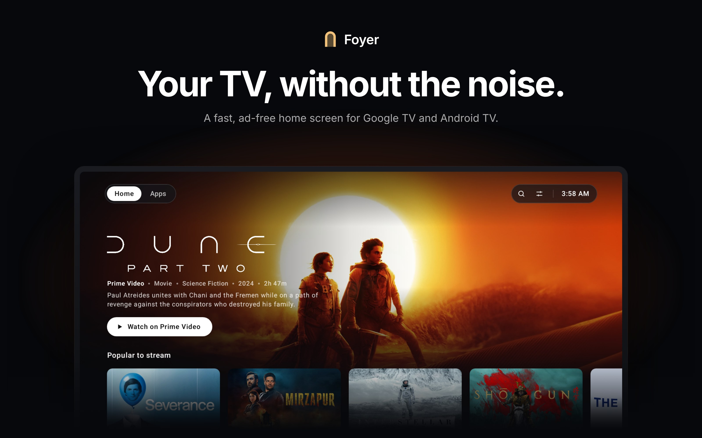
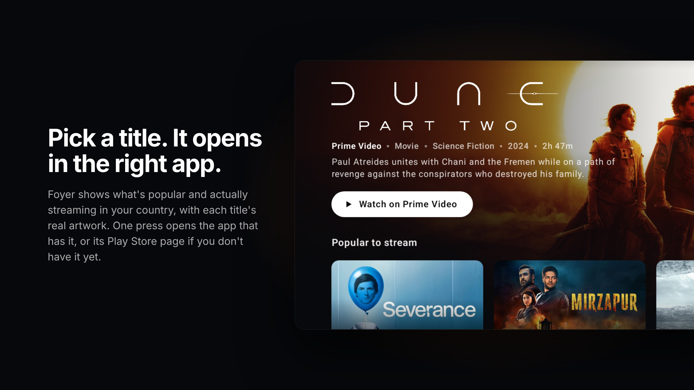
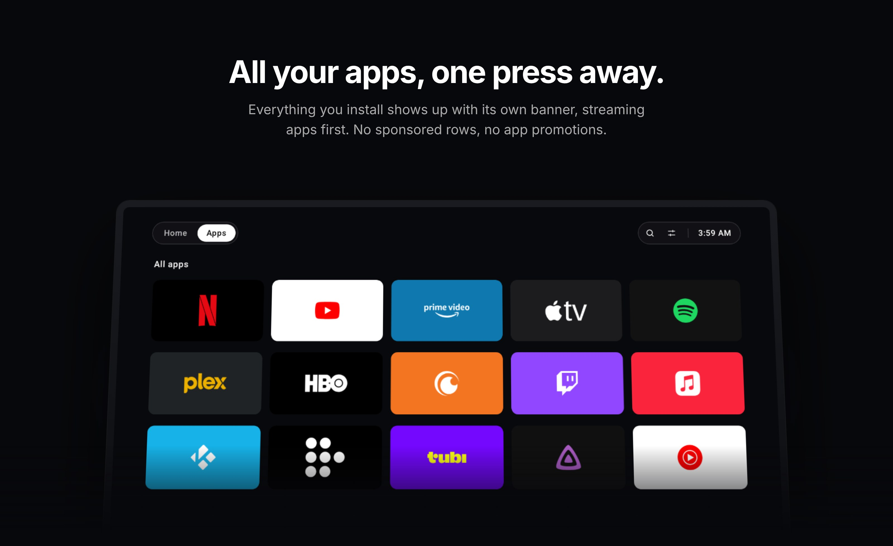
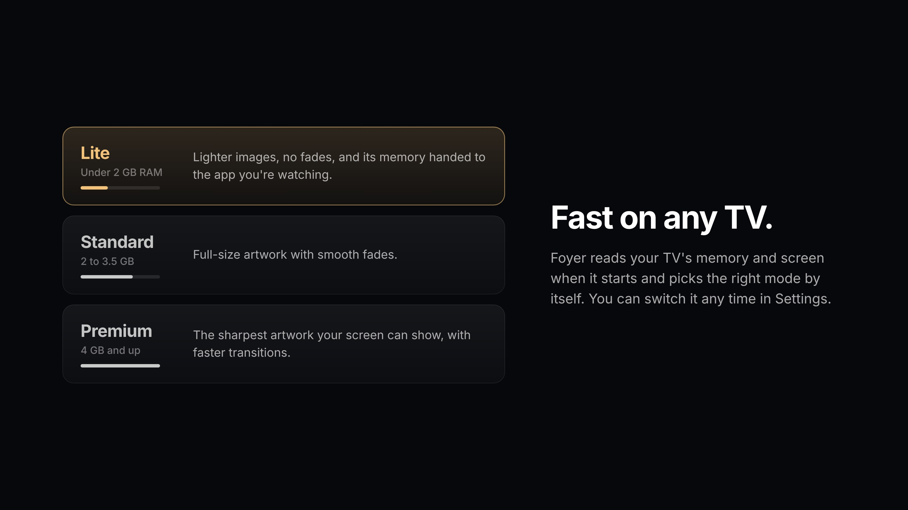
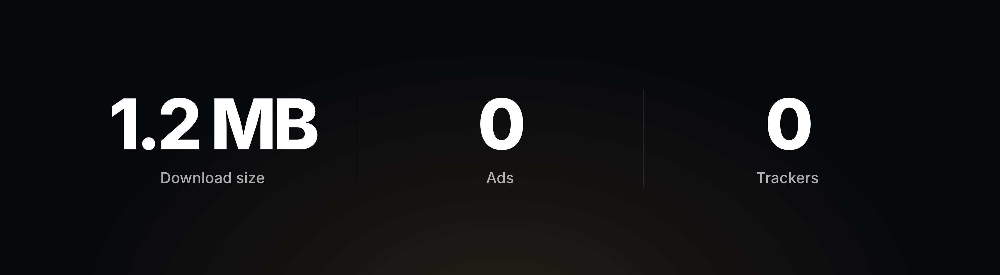

<p align="center"></p>

<p align="center"><b>A fast, ad-free home screen for Google TV and Android TV.</b><br>
Real artwork, every app one press away, and a mode for every TV from 1.5 GB budget sets to flagships.</p>

<p align="center"><a href="https://github.com/PushkarX-Code/foyer/releases/latest/download/foyer.apk"><b>Download the latest build</b></a> · <a href="#install-on-a-tv-no-computer-needed">Install on a TV</a></p>






Every screen above is rendered from the app's own code (see Screenshot tests below), framed in `docs/showcase/src`.

# Foyer

Working name; it can be renamed freely until the first Play Store release.

It replaces the TV's home screen only. Streaming apps, sign-ins and 4K/HDR playback
stay exactly as they are, because they still run in their own certified apps.

## What phase 1 does

- Full-screen artwork of what's trending, with the official title logo, where it
  streams in your country, and one button that opens it in the right app (or its
  Play Store page if the app isn't installed).
- Your installed apps as TV banners, streaming apps first, updated as you install or
  remove apps.
- Search and voice through the TV's own search.
- Three performance tiers picked from the TV's RAM and screen, switchable in
  Settings:
  - **Lite** (under ~2 GB RAM): 16-bit images, no fades, image memory released
    whenever another app is open so Netflix and the rest get it.
  - **Standard**: full-size artwork with fades.
  - **Premium**: largest artwork for the screen, faster transitions, bigger cache.
- A check in Settings that shows whether this TV lets launchers read other apps'
  "continue watching" lists.

Without an artwork key the home screen falls back to an app grid.

## Install on a TV (no computer needed)

1. On the TV, install **Downloader** (by AFTVnews) from the Play Store.
2. Settings > Device Preferences > Security & restrictions: allow Downloader to
   install unknown apps. On some Google TVs this is under Apps > Security.
3. Open Downloader and enter
   `github.com/PushkarX-Code/foyer/releases/latest/download/foyer.apk`
4. Install, then press Home.

Every push to `main` publishes a new build at the same address. Installing it again
updates Foyer in place.

## Make it the home screen on Google TV

Google TV hides the "default home app" setting. One-time setup from a Mac or PC on
the same Wi-Fi:

1. TV: Settings > System > About, press OK on **Android TV OS build** 7 times to
   unlock developer options. Then Settings > System > Developer options > turn on
   **USB debugging** (and **Wireless debugging** if listed).
2. Computer: install adb (`brew install android-platform-tools` on a Mac).
3. Run `scripts/set-default.sh <tv-ip>`. It lists the TV's home screens and asks
   before switching each one off. Nothing is uninstalled.
4. To undo: `scripts/restore.sh <tv-ip>`.

`scripts/inspect-tv.sh <tv-ip>` only reads: it saves model, memory, storage and the
app list to `tv-report.txt`, used to plan safe debloating for a specific TV.

## Build

Requires JDK 17+ and the Android SDK (platform 35).

```bash
./gradlew assembleRelease
```

Artwork comes from TMDB. Get a free API Read Access Token at themoviedb.org
(Settings > API), then either add `TMDB_TOKEN=...` to `~/.gradle/gradle.properties`
or, for CI builds, add it as a repository secret named `TMDB_TOKEN`. The token ends
up inside the APK, so use a read-only TMDB token and nothing else.

### Screenshot tests

Render the home screen without a TV:

```bash
FOYER_ART_DIR=/path/to/sample/art ./gradlew recordPaparazziDebug
```

Images land in `app/src/test/snapshots/images` (not committed). To rebuild the
showcase, copy them into `docs/showcase/screens/` and run
`node docs/showcase/src/render.js` (needs Playwright).

Film and series artwork shown in the showcase belongs to its owners and is used to
illustrate the app; it comes from TMDB.

## Signing

`app/dev.keystore` is a development key, committed on purpose so every build
installs over the previous one. The Play Store release will use a separate private
key that never goes in this repo.

## Not in phase 1

Movies/Shows/Library tabs, one-press install tiles for apps you don't have, the
accessibility-based default-home method, real glass blur on Premium, and baseline
profiles for faster startup.
